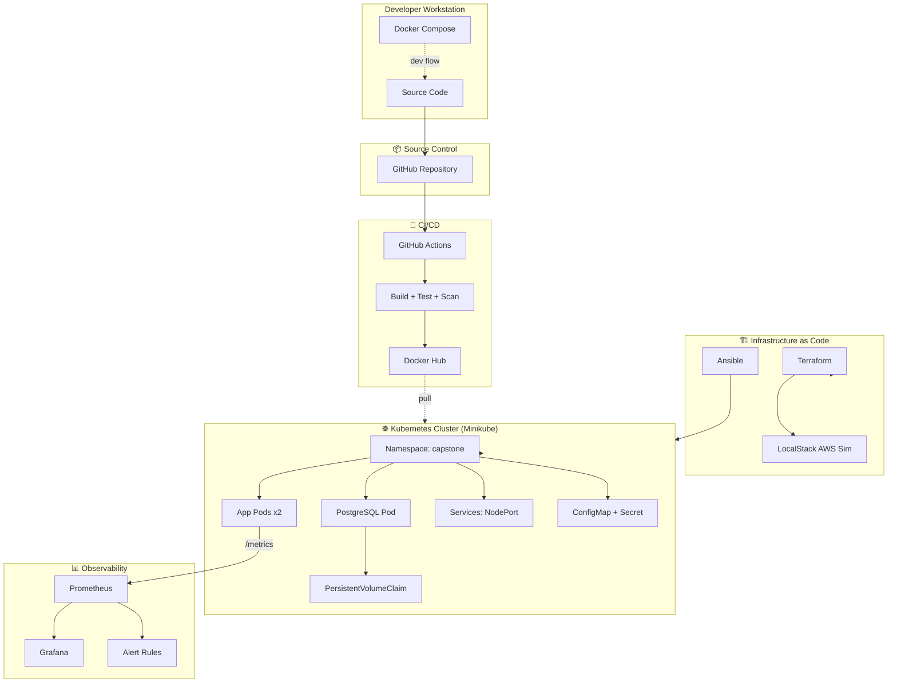
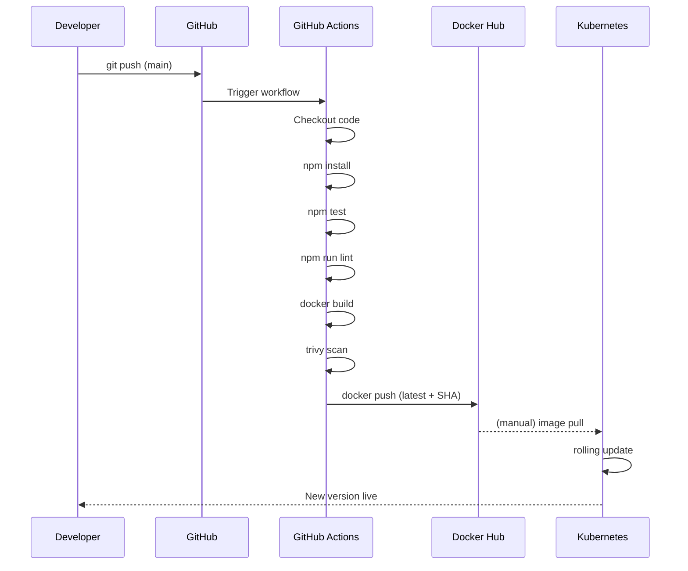
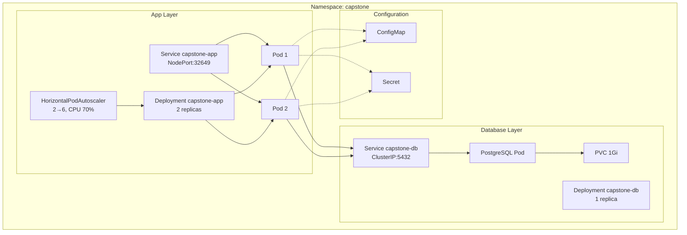
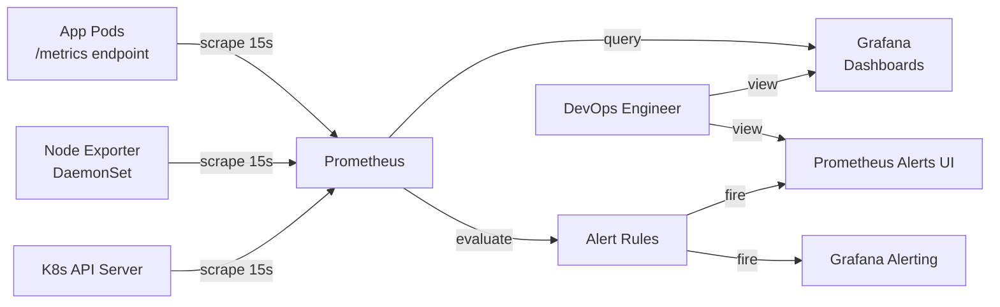

# 🏗 Architecture Deep Dive

## 1. High-Level System Architecture

---

## 2. CI/CD Pipeline Flow

---

## 3. Kubernetes Resource Topology

---

## 4. Monitoring Data Flow

**Scrape targets:**
| Job | Targets | Interval |
|-----|---------|----------|
| `capstone-app` | 2 app pods | 15s |
| `kubernetes-apiservers` | kube-apiserver | 15s |
| `node-exporter` | Node (host metrics) | 15s |
| `prometheus` | Self | 15s |

---

## 5.
