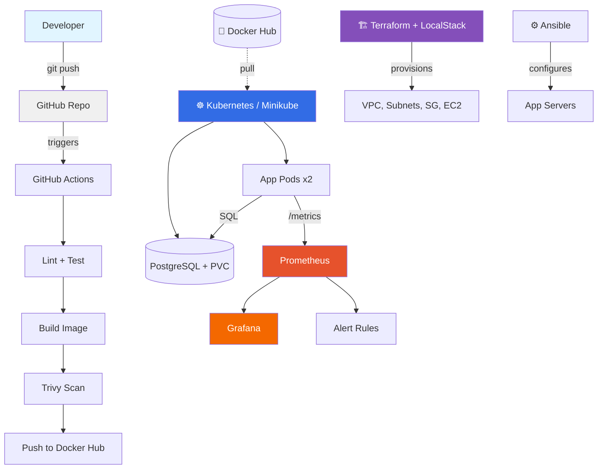

#  DevOps Engineering Capstone Project

> **Production-ready DevOps pipeline for a cloud-native 3-tier application** — built entirely with free, local-first tooling.

[](https://github.com/Bushfigure/capstone-project/actions/workflows/ci-cd.yml)

---

## Overview

This capstone project demonstrates an end-to-end DevOps workflow for a containerized 3-tier application (frontend + backend + database). It covers every stage of the software delivery lifecycle: **source control → build → test → scan → package → deploy → monitor**, with Infrastructure as Code and configuration management layered on top.

**Original brief:** [LIT DevOps Capstone Project Brief](https://lampnet.edu.ng)  
**Program:** LIT DevOps Engineering — March 2026 Cohort  
**Author:** Samuel Olumide Aransiola ([@Bushfigure](https://github.com/Bushfigure))

---

## 🏗 Architecture



### Flow Summary

1. **Developer** pushes code to **GitHub**
2. **GitHub Actions** runs the pipeline: lint → test → build Docker image → Trivy scan → push to **Docker Hub**
3. **Terraform** provisions AWS-style infrastructure (VPC, subnets, security groups, EC2) using **LocalStack** for free local execution
4. **Ansible** configures app servers (installs Docker, deploys config)
5. **Kubernetes** (Minikube) pulls the image and runs the app with 2 replicas + PostgreSQL
6. **Prometheus** scrapes `/metrics` from the app; **Grafana** visualizes; alerts fire on failure

---

## 🧰 Tech Stack

| Layer | Tool | Purpose |
|-------|------|---------|
| **Application** | Node.js 20 + Express | REST API + serves frontend |
| **Database** | PostgreSQL 16 | Persistent storage |
| **Containerization** | Docker | Build, package, run |
| **Registry** | Docker Hub | Image storage |
| **CI/CD** | GitHub Actions | Build, test, scan, push |
| **IaC** | Terraform + LocalStack | Provision AWS-like infra |
| **Config Mgmt** | Ansible | Install Docker, deploy config |
| **Orchestration** | Kubernetes (Minikube) | Run app on cluster |
| **Monitoring** | Prometheus + Grafana | Metrics + dashboards |
| **Security** | Trivy, ESLint, non-root containers | Scanning + hardening |

---

## 📁 Repository Structure

```
capstone-project/
├── .github/workflows/           # CI/CD pipeline
│   └── ci-cd.yml
├── app/                         # Node.js application
│   ├── public/index.html        # Frontend
│   ├── src/                     # server.js, db.js, metrics.js
│   ├── tests/                   # Jest test suite
│   ├── Dockerfile               # Multi-stage build
│   └── package.json
├── kubernetes/                  # K8s manifests
│   ├── 00-namespace.yml
│   ├── 01-secret.yml
│   ├── 02-configmap.yml
│   ├── 03-postgres-pvc.yml
│   ├── 04-postgres-deployment.yml
│   ├── 05-postgres-service.yml
│   ├── 06-app-deployment.yml
│   ├── 07-app-service.yml
│   ├── 09-app-hpa.yml
│   └── 08-app-ingress.yml.bak
├── monitoring/                  # Prometheus + Grafana
│   ├── 00-namespace.yml
│   ├── 01-prometheus-rbac.yml
│   ├── 02-prometheus-config.yml
│   ├── 03-prometheus-rules.yml
│   ├── 04-prometheus-deployment.yml
│   ├── 05-prometheus-service.yml
│   ├── 06-node-exporter.yml
│   └── 07-grafana.yml
├── terraform/                   # Infrastructure as Code
│   ├── main.tf, variables.tf, outputs.tf, versions.tf
│   └── modules/
│       ├── vpc/
│       └── compute/
├── ansible/                     # Configuration management
│   ├── playbook.yml
│   ├── inventory.ini / inventory-local.ini
│   └── roles/
│       ├── docker/
│       └── app-server/
├── docs/                        # Documentation & screenshots
│   ├── ARCHITECTURE.md
│   ├── DEMO-SCRIPT.md
│   ├── SCREENSHOTS.md
│   └── screenshots/
├── docker-compose.yml           # Local dev stack
├── REFLECTION.md                # What failed, how fixed
└── README.md                    # This file
```

---

##  Prerequisites

| Tool | Version | Install |
|------|---------|---------|
| Docker | 24+ | [docs.docker.com](https://docs.docker.com/engine/install/) |
| Docker Compose | v2 | bundled with Docker |
| Node.js | 20+ | [nodejs.org](https://nodejs.org) |
| kubectl | 1.28+ | [kubernetes.io](https://kubernetes.io/docs/tasks/tools/) |
| Minikube | 1.35+ | [minikube.sigs.k8s.io](https://minikube.sigs.k8s.io/docs/start/) |
| Terraform | 1.5+ | [developer.hashicorp.com](https://developer.hashicorp.com/terraform/install) |
| Ansible | 2.15+ | `sudo apt install ansible` |
| LocalStack | Docker image | `docker pull localstack/localstack:3.5` |

---

##  Quick Start — Local Development

```bash
git clone https://github.com/Bushfigure/capstone-project.git
cd capstone-project

# Bring up app + Postgres
docker compose up -d --build

# Wait ~15s, then verify
docker compose ps
curl http://localhost:8080/health        # {"status":"healthy"}

# Open the app
xdg-open http://localhost:8080
```

**Expected output:**
- App container serving the polished card UI
- Visit counter that increments on button click
- Database persisted in a Docker volume

### Run tests locally

```bash
cd app
npm install
npm test
# Expected: 5 passing tests
```

---

## 🔄 CI/CD Pipeline

**Workflow file:** [`.github/workflows/ci-cd.yml`](.github/workflows/ci-cd.yml)

**Trigger:** Push to `main`/`develop`, or PR to `main`

### Pipeline Stages

| Stage | Tool | Purpose |
|-------|------|---------|
| 1. Checkout | `actions/checkout@v4` | Clone repo |
| 2. Setup Node | `actions/setup-node@v4` | Node 20 + npm cache |
| 3. Install | `npm install` | Dependencies |
| 4. Lint | `npm run lint` | Static analysis (non-blocking) |
| 5. Test | `npm test` | Jest unit tests |
| 6. Coverage | `upload-artifact@v4` | Save coverage report |
| 7. Docker Build | `docker/build-push-action@v5` | Multi-stage build |
| 8. Trivy Scan | `aquasecurity/trivy-action` | Vulnerability scan |
| 9. Push | to Docker Hub | `bushfigure/capstone-app:latest` + SHA tag |

**Required GitHub secrets:**
- `DOCKERHUB_USERNAME`
- `DOCKERHUB_TOKEN`

**Result:** Every push to `main` produces a versioned, scanned Docker image ready for deployment.

---

## ☸️ Kubernetes Deployment

### Prerequisites

```bash
minikube start --driver=docker --cpus=2 --memory=4096
kubectl get nodes        # wait for Ready
```

### Build & load image into Minikube

```bash
eval $(minikube docker-env -u)     # ensure host context
docker build -t capstone-app:local ./app
minikube image load capstone-app:local
```

### Apply manifests

```bash
kubectl apply -f kubernetes/
kubectl get pods -n capstone -w
```

**Expected:**
```
capstone-app-xxxxx   1/1   Running
capstone-app-yyyyy   1/1   Running
capstone-db-zzzzz    1/1   Running
```

### Access the app

```bash
minikube service capstone-app -n capstone --url
# → http://192.168.49.2:32649
```

### Features deployed

- **2 replicas** with rolling update strategy
- **Readiness + liveness probes** on `/ready` and `/health`
- **Resource limits** (100m–500m CPU, 128–256Mi memory)
- **HPA** scaling 2→6 replicas on 70% CPU
- **ConfigMap** for non-secrets, **Secret** for DB creds
- **PVC** (1Gi) for Postgres persistence

---

## 🏗 Infrastructure as Code — Terraform + LocalStack

### Start LocalStack

```bash
docker run -d --name localstack \
  -p 4566:4566 \
  -v /var/run/docker.sock:/var/run/docker.sock \
  localstack/localstack:3.5

curl http://localhost:4566/_localstack/health
```

### Provision infrastructure

```bash
cd terraform
terraform init
terraform validate
terraform plan
terraform apply -auto-approve
```

**Provisioned resources:**

| Resource | Value |
|----------|-------|
| VPC | `10.0.0.0/16` |
| Public subnets | `10.0.1.0/24`, `10.0.2.0/24` (2 AZs) |
| Private subnets | `10.0.11.0/24`, `10.0.12.0/24` |
| Internet Gateway | Attached to public route table |
| Security Group | SSH (22), HTTP (80), NodePort (30080) |
| EC2 Instance | `t3.micro` in public subnet |

### Verify

```bash
docker exec localstack awslocal ec2 describe-vpcs --output table
docker exec localstack awslocal ec2 describe-instances --output table
terraform output
```

### Idempotency proven

```bash
terraform apply -auto-approve
# → No changes. Your infrastructure matches the configuration.
```

### Tear down

```bash
terraform destroy -auto-approve
```

---

##  Configuration Management — Ansible

### Run playbook

```bash
cd ansible
ansible-playbook playbook.yml --check     # dry run
ansible-playbook playbook.yml             # apply
```

### Roles

| Role | Tasks |
|------|-------|
| `docker` | Install Docker, enable service, verify |
| `app-server` | Create app dir, render `app.env` from template, verify image |

### Inventory

- `inventory-local.ini` — runs against `localhost` (demo)
- `inventory.ini` — production template (AWS EC2 target)

---

##  Monitoring & Logging

### Deploy monitoring stack

```bash
kubectl apply -f monitoring/
kubectl get pods -n monitoring -w
```

**Components:**
| Component | Purpose | Port |
|-----------|---------|------|
| Prometheus | Scrapes app metrics every 15s | 30090 |
| Grafana | Dashboards + alerting UI | 32000 |
| Node Exporter | Host-level metrics (CPU, memory) | (internal) |

### Access

```bash
minikube service prometheus -n monitoring --url     # → http://...:30090
minikube service grafana -n monitoring --url        # → http://...:32000
```

**Grafana login:** `admin` / `capstone-admin`

### Metrics tracked

- `app_http_requests_total` — HTTP request counter
- `app_visits_total` — Visit events
- `up{job="capstone-app"}` — Pod availability
- `node_cpu_seconds_total` — Node CPU
- `container_memory_working_set_bytes` — Memory per pod

### Alerts defined

| Alert | Condition | Severity |
|-------|-----------|----------|
| `CapstoneAppDown` | `up{job="capstone-app"} == 0` for 1m | Critical |
| `CapstoneAppHighRequestRate` | `rate(app_http_requests_total[5m]) > 10` | Warning |
| `CapstoneAppHighMemory` | Memory > 80% of limit for 5m | Warning |

### Grafana Dashboard

**"Capstone App Monitoring"** with 5 panels:
1. App Replicas UP (stat)
2. App HTTP Request Rate (time series)
3. Total Visit Events (time series)
4. App Memory Usage by Pod (time series)
5. Node CPU Usage (time series)

---

##  Security Practices

| Practice | Implementation |
|----------|---------------|
| **No hardcoded secrets** | Env vars in Docker, K8s Secrets for DB creds, GitHub Secrets for Docker Hub token |
| **Non-root containers** | Dockerfile creates `app` user, runs as UID 1000 |
| **Image scanning** | Trivy in CI pipeline, blocks on CRITICAL/HIGH (informational) |
| **Linting** | ESLint on every push |
| **Least-privilege IAM** | Security groups restrict inbound to specific ports |
| **Read-only probes** | Health endpoints expose no sensitive info |
| **Git ignore hygiene** | `.env`, `node_modules`, `.terraform`, secrets excluded |
| **Container port isolation** | DB not exposed publicly (internal K8s service only) |

**Security decisions documented in [REFLECTION.md](REFLECTION.md).**

---

##  Rollback & Recovery Plan

### Application rollback

```bash
# Revert to previous image version
kubectl rollout undo deployment/capstone-app -n capstone

# Or roll back to a specific revision
kubectl rollout history deployment/capstone-app -n capstone
kubectl rollout undo deployment/capstone-app -n capstone --to-revision=2
```

### Database recovery

```bash
# Data persists in PVC. To inspect:
kubectl exec -n capstone deployment/capstone-db -- pg_dump -U appuser appdb > backup.sql
```

### Full stack rebuild

```bash
cd ~/Documents/capstone-project
kubectl delete namespace capstone monitoring
kubectl apply -f kubernetes/
kubectl apply -f monitoring/
```

### Docker Compose (local)

```bash
docker compose down
docker compose up -d --build
```

---

##  Screenshots

See [`docs/screenshots/`](docs/screenshots/) for the full evidence set. Index with descriptions in [`docs/SCREENSHOTS.md`](docs/SCREENSHOTS.md).

Highlights:

| Screenshot | Proves |
|------------|--------|
| `Actions page (all green).png` | CI/CD pipeline passes |
| `Grafana dashboard.png` | Monitoring works |
| `Prometheus query.png` | Metrics scraped |
| `App In browser old UI.png` + new UI | App runs on K8s |

---

##  Reflection

See **[REFLECTION.md](REFLECTION.md)** for a detailed account of every issue encountered (AppArmor bugs, IPv6 DNS failures, port conflicts, stale Docker networks) and how each was solved.

---

##  License

MIT — see [LICENSE](LICENSE) for details.

---

##  Links

- **Repository:** https://github.com/Bushfigure/capstone-project
- **Docker Hub:** https://hub.docker.com/r/bushfigure/capstone-app
- **CI/CD:** https://github.com/Bushfigure/capstone-project/actions

---

**Built as part of the LIT DevOps Engineering Program — March 2026 Cohort** 🎓
